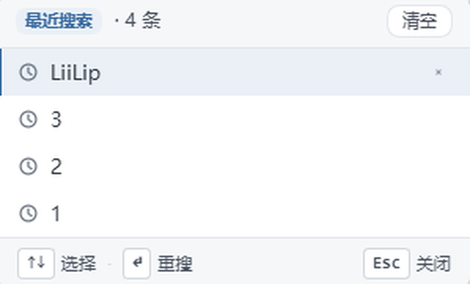

# everything-search

在 DeepSeek Harness 里直接搜本机文件：搜索、双击打开、在资源管理器里定位、复制路径。
底层调用 Everything 的官方命令行 `es.exe`，通过 IPC 复用你**已经在跑**的 Everything 索引 —— 不改 Everything 配置、不重启 Everything、不需要管理员权限。

<p>
  
</p>

主面板：一处输入直搜本机文件。页签切全部 / 文件 / 文件夹，可按匹配路径、整词、区分大小写、正则筛选，右上角选排序与返回条数，下面一行是 Everything 的实时索引状态。

<p>
  
</p>

聚焦未输入时弹出「最近搜索」，最多 50 条、默认露 8 条、可展开，支持单条删除与一键清空。

## 它长什么样

**① 右上角常驻搜索栏**（会话标题栏最右侧的胶囊）：随手打字即搜，不等面板。

- 输入即搜（140ms 防抖），下拉面板显示前 12 条，每行显示文件名 + 所在目录 + 大小
- `Enter` 打开、`Ctrl+Enter` 在资源管理器定位、`↑↓` 选择、`Esc` 关闭/清空、点行直接打开
- 面板会显示本次用时；命中总数在结果出来后再补一次（不拖慢首屏），命中缓存时标注「缓存」

**② 左侧边栏「文件搜索」面板**：点开是主区完整面板。

- 搜索框输入即搜（140ms 防抖），支持 Everything 原生语法：`ext:pdf`、`path:D:\work`、`size:>100mb`、`datemodified:today`、`content:关键词`
- 工具条：全部 / 文件 / 文件夹、匹配路径、区分大小写、全字匹配、正则、排序（相关度/名称/路径/大小/修改时间/类型）、条数（50/80/200/500）
- 结果行显示图标、文件名（搜索词高亮）、完整路径、大小、修改时间
- 双击 = 打开；Ctrl+Enter = 在资源管理器定位；hover 出「打开 / 定位 / 复制路径」三个按钮
- 键盘：↑↓ 选择、Enter 打开、Esc 清空
- 底栏显示命中总数与耗时（总数是二段式懒补的）
- 亮/暗色跟随系统与 DSH 主题（`prefers-color-scheme` + `data-theme` / `data-dsw-theme` / `.dsh-theme-dark` 多重兜底）

**③ 最近搜索**：搜索框聚焦且还没输入时，弹层切到历史视图。

- 最多留 50 条关键词（`HIST_MAX`），大小写无关去重、最近的排在最前
- 默认只露 8 条（`HIST_COLLAPSED`），右上角「展开 N / 收起」按钮可展开到 50 条（列表区从 `min(236px,40vh)` 撑到 `min(440px,60vh)`，超出可滚）
- 每行 hover 出删除按钮，清掉这一条；「清空」一次全清
- 历史态底栏不显示「`Ctrl+↵` 定位」——那个动作在这个视图里没有意义，只留「选择 / 重搜 / `Esc` 关闭」
- 点历史条目 = 用它重搜，不是打开文件

## 排序规则（「相关度」到底是什么）

`sort` 为空 = 相关度模式，**不是** es.exe 的原生顺序。es.exe 默认按名称排序，而 `+`(0x2B) 这类字符排在字母前，所以搜 `QT` 曾经被 `.mqtt\+qt_tutorials` 之类的 MATLAB 工具箱路径霸榜，桌面上的 `QT` 文件夹反而排到 16227 名之后。

现在的做法（`index.js` 的 `doSearch` + `scoreItem`）：

1. **并行两路探针**：宽命中 `<q>` + `wfn:<q>`（Everything 的全名精确匹配，实测 137ms）。两路结果按路径去重合并。
2. **自研打分**：文件名全等 `+1200`、前缀 `+760`、子串 `+330`、仅路径命中 `+60`；短文件名加权；路径层级越浅越高；`\desktop\` `+150`、`\documents\` `+110`、`\downloads\` `+100`；系统目录（Program Files / Windows / Anaconda / site-packages / node_modules / .git / AppData Temp）`-90`。
3. 分页在内存里做（相关度模式 offset 归零后重排再切片），翻页不会打乱名次。

实测 `q=QT`：第 1 名 `D:\Users\32720\Desktop\QT`（改造前排第 16227），第 2 名 `D:\Harness_Workspace\QT`。

选显式排序（名称/路径/大小…）时直通 es.exe 原生 `-sort`，不做重排。

## 性能

- **es.exe 进程启动 ≈105ms 是硬地板**（`es.exe -version` 也要 102–110ms），真正检索只占约 65ms，与结果条数几乎无关（`-n 5` 与 `-n 240` 都是约 170ms）。
- 因此一次搜索 ≈ 两个探针并行 ≈ 170–250ms；`/count` 的全量扫描（约 180ms）已移出关键路径，由前端拿到结果后再单独请求。
- 同一查询参数 60 秒内直接命中内存缓存（`searchCache`，上限 160 条，LRU 淘汰），命中即 0ms。
- 想再快只能启用 Everything 的 HTTP Server（需改 `Everything.ini` 并重启 Everything），本插件没有走这条路，因为 es.exe 复用现有索引、零配置改动。

## 依赖

| 项 | 说明 |
| --- | --- |
| Everything 1.4+ | 建议正在运行（本机实测 1.4.1.1026）。索引由它维护，本插件只读取 |
| `bin/es.exe` | 已随插件附带，版本 1.1.0.27（来自 voidtools ES 官方包） |
| DSH | `>=0.2.0`（`dsh.engines.dsh`） |
| Node | `>=22`（只用内置模块，无第三方依赖） |

### 没有装 Everything 会怎样

面板照常安装、照常打开，**不会报错、不会让宿主加载失败**：

- 没有 `bin/es.exe` / 找不到 Everything → `/search` 返回 `{ ok: true, data: { unavailable: true, code: "ES_NO_ES", reason } }`，前端显示黄色提示条「暂时搜不了」而不是红色报错
- Everything 装了但没运行 → `code: "ES_NOT_RUNNING"`，插件会自动尝试拉起一次 `Everything.exe -minimized`（105ms 级），拉不起来再给提示
- 刚拉起、索引还没就绪 → `code: "ES_NOT_READY"`
- es.exe 在但查询超时/参数不被该版本支持/索引重建中 → `code: "ES_QUERY_FAILED"`，给空态 + 一句说明
- 总数扫描失败 → 只是不显示总数（`total: null`），不影响结果列表

也就是说：**软失败（环境不具备）走 200 + `unavailable`；只有真正的代码故障才是 500**。前端据此分黄色（`data-tone="warn"`）和红色（`data-tone="bad"`）两态渲染。

## HTTP 接口

基址 `/api/plugins/everything-search`，共 9 条路由，统一信封 `{ ok: true, data }` / `{ ok: false, error }`。

| 方法 | 路径 | 参数 | 说明 |
| --- | --- | --- | --- |
| GET | `/status` | — | `esPath` `exists` `esVersion` `everythingVersion` `ipcRunning` `everythingExe` `error` `platform` `home` `plugin` `routeBase` `build` `routes` `warm` |
| GET | `/search` | `q` `limit` `offset` `sort` `order` `kind` `matchPath` `matchCase` `wholeWord` `regex` `count` | 返回 `{ items, total, limit, offset, elapsedMs, probeMs, countMs, hasMore, relevance, query }`；`count=0` 跳过总数扫描；`q` 为空时返回 `note: "empty-query"` |
| GET | `/count` | `q` + 同上过滤项 | `{ total, query }`，供前端二段式补总数 |
| GET | `/ls` | `path` | 内嵌文件浏览器用：列目录，`path` 为空/非法则回落到盘符列表（Windows 枚举 `A:`–`Z:` 中存在的盘，其他平台给 `/`） |
| POST | `/open` | `{ path }` | `explorer.exe <path>` 打开（仅 Windows） |
| POST | `/reveal` | `{ path }` | `explorer.exe /select,<path>` 定位（仅 Windows） |
| POST | `/copy` | `{ text }` | 把路径写进剪贴板 |
| GET | `/probe` | `path` | `{ exists, isDir, size, mtime }`；路径含控制字符时直接 `{ exists: false }`，永不 500 |
| GET | `/blob` | `path` | 图片类文件预览用的字节流 |

`items[]` 字段：`{ name, path, dir, isDir, ext, size, mtime, attributes }`。

**软失败**不走 500：`data` 里带 `{ unavailable: true, code, reason }` 与空 `items`，`code` 取值 `ES_NO_ES` / `ES_NOT_RUNNING` / `ES_NOT_READY` / `ES_ES_TOO_OLD` / `ES_QUERY_FAILED` / `ES_COUNT_FAILED` / `ES_CLIPBOARD`。只有未捕获的真故障才回 `{ ok: false, error }`。

**入参校验**（这些是 `ok: false` 的 4xx，不是故障，前端按提示文案处理即可）：

| HTTP | `code` | 触发条件 |
| --- | --- | --- |
| 400 | `ES_BAD_JSON` | `POST` 的 body 不是合法 JSON |
| 400 | `ES_BAD_PATH` | `path` 含控制字符（`\0` 之类，`fs` 收到会抛 TypeError 而非 ENOENT） |
| 400 | `ES_EINVAL` | `path` 语法上过不了 `fs.stat`（超长、非法参数等） |
| 400 | `ES_PLATFORM` | 非 Windows 上调 `/open` `/reveal` `/copy` |
| 404 | `ES_ENOENT` | 打开/定位的目标不存在（`explorer.exe` 对不存在的路径照样 exit 0，所以必须自己先查） |
| 405 | `ES_METHOD` | 方法不在该路由的白名单里，响应带 `Allow` 头 |
| 413 | `ES_BODY_TOO_LARGE` | body 超过 2MB（**会正常返回响应体**，不是断连） |

方法白名单：`/status` `/search` `/count` `/ls` 只接受 `GET`；`/open` `/reveal` `/copy` 只接受 `POST`；`/probe` 两者都收；`/blob` 不走统一包装，只接受 `GET`。

```powershell
# 装好并重启宿主后自检（端口以你的 DSH_WEB_URL 为准，本机是 57478）
curl.exe "http://127.0.0.1:57478/api/plugins/everything-search/status"
curl.exe "http://127.0.0.1:57478/api/plugins/everything-search/search?q=ext:pdf&limit=5"
```

## 实现要点（改代码前先看这段）

- **零裸包依赖**：`index.js` 只用 `node:child_process` / `node:fs` / `node:path` / `node:url`；`client.js` 只 `require('react')`。`link:` 安装的本地插件没有 `node_modules`，任何裸包 import 都会让宿主解析失败。
- **服务必须经 `ctx.inject` 获取**：冷启动时 `ctx.tools` / `ctx.webServer` 往往还没就绪，直接 `ctx.get()` 会拿到 `null` 并静默跳过注册（表现为"面板能开、接口全 404"）。本插件用 `ctx.inject(['webServer'], host => registerRoutes(host?.webServer ?? tryService(ctx, 'webServer')))`。
- **es.exe 输出是 GBK**：stdout 用 `new TextDecoder('gbk')` 解码（Node 18+ 内置 ICU 即支持），不要按 utf8 读，否则中文路径全是 `锟斤拷`。
- **CSV 列顺序 = 开关出现顺序，`Filename` 恒在最后**：所以 `buildSearchArgs` 里列开关的顺序即表头顺序，`mapRows` 按表头名取值而不是按位置硬编码。
- **`-` / `/` 开头的查询会让 es.exe 挂死**：`escapeQueryForEs()` 给这类查询套双引号；同时每次 spawn 都有硬超时 `child.kill()`（8s），并给 es 传 `-timeout 5000`。
- **目录判定看 Attributes**：含 `D` 即目录（`D` / `DCI`），目录 Size 恒为 `0`。

## 安装 / 卸载

两种装法，选一种：

**A. 从本地目录（开发/自用）**

```powershell
& "C:\Users\32720\AppData\Local\Programs\DeepSeek Harness\resources\runtime\cli\bin\dsh.cmd" `
  plugin --profile desktop add "link:C:\Users\32720\.dsh\plugins\everything-search"
```

**B. 手工挂 patch（包已解到 plugins 目录，宿主没自动认）**

把 `cordis.patch.yml` 里的 insert 段追加到 `~/.dsh/profiles/<profile>/cordis.patch.yml`：

```yaml
- insert:
    - id: everything-search
      name: 'everything-search'
```

改完重启宿主即可（本机当前就是这个状态：`profiles\desktop\node_modules\everything-search` 是指向插件目录的 junction）。

卸载：

```powershell
& "C:\Users\32720\AppData\Local\Programs\DeepSeek Harness\resources\runtime\cli\bin\dsh.cmd" `
  plugin --profile desktop remove everything-search
```

手工回滚：用 `profiles\desktop\package.json.bak-es-20261108-205607` 覆盖回去，再删掉 node_modules 里的 junction。

## 离线自测（不重启宿主也能验）

```powershell
cd C:\Users\32720\.dsh\plugins\everything-search
node .selftest\probe.mjs
```

`.selftest\probe.mjs` 用假 `ctx` 加载 `index.js`，把 `buildRoutes()` 的 handler 挂到一个只监听 `127.0.0.1` 的临时端口上，然后打真实 HTTP 请求，覆盖 20 个断言：非 JSON body → 400、超大 body → 413 且有响应体、控制字符 path → 400、方法白名单 → 405 + `Allow`、打开不存在的路径 → 404、以及 `/status` `/search` `/ls` `/blob` 正常路径不被误伤。

它**不碰宿主进程、不重启 Harness、不写任何用户数据**（唯一副作用是 `apply()` 里的预热会 spawn 一次 `bin\es.exe` 做只读探测）。`files` 白名单没包含 `.selftest`，所以它只在本机开发时用，不会跟着包发出去。

## 已知边界

- 只读 Everything 的已有索引：没被 Everything 索引的盘/目录搜不到（在 Everything 里加索引即可）
- 打开/定位走 `explorer.exe`，只在 Windows 生效；其他平台 `/status` 会返回 `platform` 供前端判断
- `es.exe` 每次搜索是一个新进程（启动地板 105ms），高频输入靠 140ms 防抖 + `AbortController` 抑制
- **es.exe 版本比 Everything 本体老**时不会抛 500：插件的搜索解析靠 `-csv` 输出的表头（`Filename` / `Size` / `Date Modified` / `Attributes`），老版本不认这些列会吐出非 CSV 或残缺的文本。这种情况现在单独识别为 `ES_ES_TOO_OLD` 软失败（200 + `unavailable` + 一句「更新 Everything 后就能用」），而不是含糊的「没搜到」。想确认版本对应关系，看 `/status` 的 `esVersion` 与 `everythingVersion` 两个字段
- `/blob` 只接受 `GET` / `HEAD`（成功时回字节流而非 JSON 信封，所以它不走统一包装，但 4xx/405 仍然带 `ok: false`）
- 单文件上限 512MB（`MAX_BLOB_BYTES`），请求体上限 2MB（`MAX_BODY`）
- **宿主层 401/403 不算插件故障**：整包路由没挂上（插件刚更新但宿主还没重启）或登录态过期时，宿主会直接回纯文本 `unauthorized`。前端把它渲染成黄色提示「刷新页面再试」，不会涂成红字
- **改完代码要重启宿主**才生效：本插件是 `link:` 装的本地包，`/status` 里的 `build` 字段就是判断依据——它不是当前源码里的 `BUILD_TAG` 就说明进程还在跑旧模块

## 宿主换代怎么不崩（兼容性清单）

插件的目标不是「冻结在 0.2.2」，而是「宿主升到不认识它的时候，安静退化成不工作，而不是把界面或宿主带崩」。四层各自兜错：

**1. 服务端 API 面只有 4 个入口，且每处都兜**
`index.js` 里全部 `ctx.*` 用法只有 `ctx[key]` / `ctx.get()` / `ctx.logger?.info?.()` / `ctx.inject()` / `ctx.effect()`。全部包在 try/catch 或可选链里；`tryService()`（`index.js:102-116`）先试属性访问、再试 `ctx.get`，取不到返回 `null`。

**2. 服务缺失一律降级，不在加载期抛**
`apply()`（`index.js:1684-1747`）不向上抛任何错误：没有 `webServer` → `notes.push('webServer 服务不可用，路由未注册')` 后直接返回；单条路由注册失败只跳过那一条；`ctx.effect` 不存在 → 吞掉。冷启动 `webServer` 未就绪时走 `ctx.inject(['webServer'], …)`，`inject` 本身不可用则回退 `tryService`，双层兜底。

**3. 客户端槽位逐个挂，一个失败不牵连其余**
`client.js` 的 `mount(scope, spec, Comp)`（`client.js:3965` 起）对四个槽位分别 `try { slots.inject(scope, put) } catch {}` + `try { slots.register(spec, Comp) } catch { return null }`。宿主改了某个 scope 名，只少一个入口（图标 / 顶部搜索栏 / 主面板 / Hero 浮层之一），其余照常。此外 `apply` 开头有 `if (!slots || typeof slots.register !== 'function') return`，`canInject` 判断宿主有没有 `slots.inject`。

**4. bundle 顶层也不裸奔**
`client.js:13` 起整体包在 `(function boot(loader) { if (!loader || typeof loader.load !== 'function') return; … })(window.__ModuleLoader__)` 里，factory 内的 `require('react')` 也包了 try/catch —— 拿不到就返回 `{ inject: [], apply() {} }` 空壳。这样即使宿主把 `__ModuleLoader__` 换名、或 factory 参数形态变了，本文件也只是不出现，不会在顶层抛 `TypeError` 连累同 bundle 里别的插件。

**已实证的契约（0.2.2-rc.x）**：四个槽位名 `sidebar.panellist` / `conversation.session.header.utilities` / `main` / `shell.overlay` 都能在宿主 `app.asar` 里找到字面量声明；客户端服务名 `slots` 与官方 client 包 `inject` 数组里的写法一致（`dsh-client-ui-schedule` 的 `inject` 首位就是 `slots`）；`main` 槽用 `key`、`sidebar.panellist` 用 `id` + `order` + `label`，与官方 `dsh-client-ui-schedule/src/client/index.ts` 相同。声明 `dsh.client.inject: ["@deepseek-ai/dsh-client-ui-layout"]` 也是宿主内真实存在的包。

**守住这些的前提**：`dsh.engines.dsh: ">=0.2.0"` 无上限，宿主升到 0.3/1.x 市场仍判 compatible；真要收紧就在 `package.json` 加顶（如 `">=0.2.0 <1.0.0"`），但那样大版本升级时市场会拦下而不是让插件自己退化。
